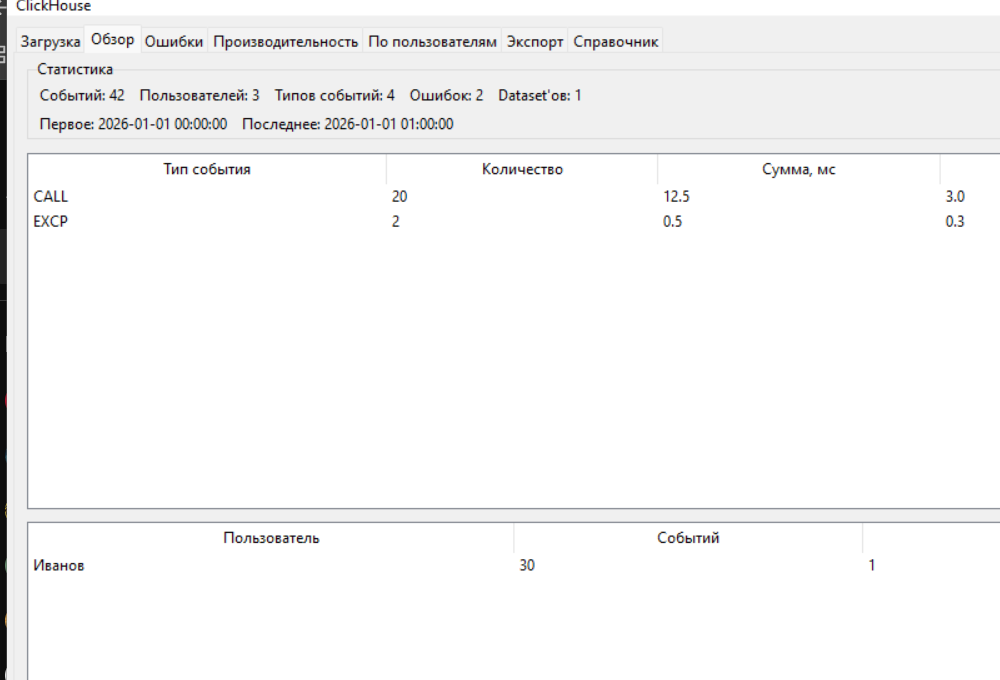
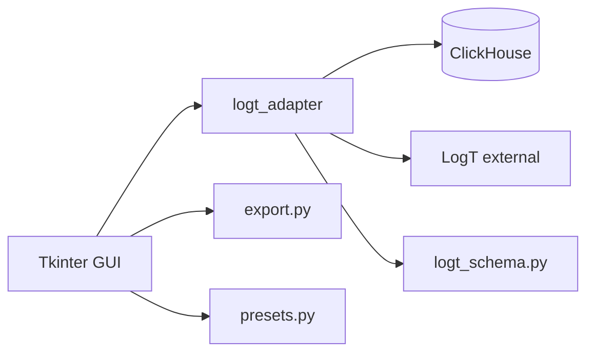

# 1C Tech Log Analyzer

[](https://github.com/Vakatr/1c-tech-log-analyzer/actions/workflows/ci.yml)
[](https://www.python.org/)
[](LICENSE)

## Что это

Python-приложение для анализа технологических логов 1С с табличным GUI.
Логи загружаются в ClickHouse через **LogT** — внешний инструмент, который
не входит в этот репозиторий. После импорта вкладки «Обзор», «Ошибки»,
«Производительность» и «По пользователям» строятся запросами к ClickHouse.
Режим разбора логов в память (без ClickHouse) сохранён и работает офлайн.

> **Публичная версия.** `vendor/logt` намеренно не бандлится: это отдельный
> проект, который может быть проприетарным. Установите его самостоятельно и
> укажите `LOGT_ROOT`, либо используйте офлайн-режим без ClickHouse. Подробнее —
> в [docs/CLICKHOUSE.md](docs/CLICKHOUSE.md).

## Скриншот



Синтетические данные, offline-режим с mock-адаптером. Реальные логи и клиентские
данные в репозиторий не входят.

## Инженерные акценты

- **579 offline-тестов** и **90% combined coverage**; CI на Ubuntu и Windows,
  Python 3.11 и 3.13, отдельный job с ClickHouse.
- Параметризованные SQL-запросы, идемпотентная схема, redaction паролей в
  ошибках, логах и аргументах дочерних процессов.
- Tk-free слой экспорта CSV/JSON/XLSX с атомарной записью и защитой формул Excel.
- Сборка Windows `.exe` через PyInstaller проверяется в CI.



## Требования
- Python 3.10+ (проверено на 3.13)
- Tkinter (входит в стандартную библиотеку)
- ClickHouse, доступный по native-протоколу (порт 9000); для импорта через LogT
  также нужен HTTP-порт 8123
- Python-зависимости: `pip install -r requirements.txt`

## Быстрый старт

```bash
# 1. Поднять ClickHouse (только для разработки; см. docs/CLICKHOUSE.md)
#    docker-compose.yml задаёт пользователя default с паролем "1".
docker compose up -d

# 2. Создать базу (приложение само базы не создаёт)
docker exec -it 1c-clickhouse clickhouse-client --password 1 \
  --query "CREATE DATABASE IF NOT EXISTS tracelog"

# 3. Указать пароль (для docker-compose из шага 1 — "1")
set CLICKHOUSE_PASSWORD=1   # PowerShell: $env:CLICKHOUSE_PASSWORD="1"

# 4. (необязательно) Проверить/создать таблицы LogT заранее
python -c "from logt_adapter import ensure_schema; s = ensure_schema(); print(s.message); raise SystemExit(0 if s.ready else 1)"

# 5. Запустить
python ics_log_analyzer.py
```

> Перед каждым импортом GUI сам вызывает идемпотентную `ensure_schema`, поэтому
> отдельный шаг 4 нужен только для ручной проверки схемы. В меню по-прежнему
> доступны «Проверить схему» (чтение) и «Сбросить схему…» (удаление после двух
> подтверждений).

## Документация

| Документ | Содержание |
| :--- | :--- |
| [docs/ARCHITECTURE.md](docs/ARCHITECTURE.md) | Слои, модули, публичный API, потоки данных |
| [docs/CLICKHOUSE.md](docs/CLICKHOUSE.md) | Импорт через LogT, запросы, настройка и ошибки |
| [docs/AGENT_GUIDE.md](docs/AGENT_GUIDE.md) | Правила изменений, стиль, конфигурация, сборка |
| [docs/TESTING.md](docs/TESTING.md) | Offline/live-тесты и окружение |
| [GUI-test.md](GUI-test.md) | Чек-лист всех кнопок GUI и команды повторной проверки |
| [docs/ISSUES.md](docs/ISSUES.md) | Баги, производительность, техдолг |
| [docs/ROADMAP.md](docs/ROADMAP.md) | План развития |
| [docs/events.md](docs/events.md) | Справочник событий технологического журнала 1С |
| [CONTRIBUTING.md](CONTRIBUTING.md) | Развёртывание окружения и процесс ревью |

## Как запустить
```bash
python ics_log_analyzer.py
```

## Вкладки

### Загрузка
Выберите папку с логами и имя dataset, затем нажмите
**«Загрузить в ClickHouse (LogT)»** — импорт выполняется в фоновом режиме, его
можно отменить кнопкой «Отменить». Кнопка «Загрузить и распарсить» оставлена для
разбора в память без ClickHouse. Здесь же находятся фильтры (пользователь,
событие, поиск, диапазон дат, процесс, AppID, минимальная длительность), которые
применяются ко всем вкладкам ClickHouse. Пресеты фильтров сохраняются в
`config/presets.json`: «Сохранить как…», «Загрузить», «Удалить», «Сбросить
все…»; последний использованный пресет восстанавливается при запуске без
автоматического запроса.

Во время импорта вкладка показывает реальный прогресс: этап («Проверка схемы
ClickHouse…», «Сканирование», «Обработка логов», «Вставка», «Подсчёт строк»,
«Готово»), счётчик `Файлов: X/Y` и процент. Если LogT не сообщает общий объём,
полоса переключается в неопределённый режим (indeterminate). Чекбокс
**«Точный прогресс (подсчёт строк, медленнее старт)»** просит LogT заранее
посчитать строки, чтобы процент был определённым. Отмена молчащего LogT
укладывается в 2 с; после неё кнопки снова активны. Успех и число загруженных
строк определяются только подсчётом в ClickHouse, а не текстом LogT.

#### Ошибки импорта

Сбой импорта — включая ошибку подготовки схемы ClickHouse — показывается
немодальным окном **«Ошибка импорта»**, а не обычным `messagebox`. В нём есть
этап, dataset, код возврата LogT, путь к журналу `trace-vrs-*.log`, последние
строки `stderr`/`stdout` и кнопки **«Скопировать детали»** и **«Закрыть»**.
Пароль ClickHouse в отчёт не попадает. После закрытия окна импорт можно сразу
повторить. Полный чек-лист — [GUI-test.md](GUI-test.md) §11.

Разбор в память читает `*.log` только из выбранной папки; LogT при импорте
рекурсивно ищет каталоги `rphost_*` и `rmngr_*`.

Повторный импорт в тот же dataset **заменяет** его: LogT перед загрузкой удаляет
строки этого dataset во всех четырёх таблицах (`ALTER TABLE … DELETE WHERE
dataset = …`). Другие dataset'ы не затрагиваются.

### Обзор
Общая статистика из ClickHouse: количество событий, пользователей, типов
событий, dataset'ов и ошибок, временной диапазон, топ-10 типов событий и
пользователей. Агрегация выполняется в ClickHouse (`count()`, `sum()`, `max()`),
а не в Python. В режиме памяти доступны только число событий, временной диапазон
и топы по событиям/пользователям.

### Ошибки
В режиме ClickHouse — события `EXCP`/`EXCPCNTX` с постраничной навигацией
(`LIMIT`/`OFFSET`). В резервном режиме памяти ошибкой считается `N=EXCP` или
непустой `Descr` (`ics_log_stats.find_errors`). Столбец «Описание (из текста
события)» формируется из текста события: отдельной колонки описания в схеме LogT
нет.

### Производительность
Топ N самых долгих событий и агрегаты по типам событий
(количество / сумма / среднее / максимум / p95) из ClickHouse. В режиме памяти
строится только список самых долгих событий, без агрегатов.

### По пользователям
Статистика по пользователям. При выборе пользователя подгружаются его события.
В режиме памяти доступны только счётчики событий и ошибок — без первого и
последнего события.

### Экспорт
Экспорт поддерживает **CSV**, **JSON** и **XLSX**. Кнопки «Сохранить обзор в
CSV», «Сохранить ошибки в CSV» и «Сохранить производительность в CSV»
по-прежнему выгружают ровно строки текущей таблицы. В блоке «Экспорт с выбором
формата» можно выбрать таблицу и область:

- **Текущая таблица** — ровно показанные строки (для ошибок — текущая страница).
- **Все отфильтрованные** — постранично все ошибки или все пользователи,
  подходящие под фильтры, с прогрессом и отменой. Для агрегатов «Обзор» и
  «Производительность» полная выгрузка недоступна: это top-N, и GUI честно
  блокирует такую комбинацию.

Выгрузка больше 10 000 строк требует подтверждения, больше 100 000 — согласия
на усечение. Файл пишется атомарно: при ошибке или отмене старый файл не
портится. CSV — `utf-8-sig`; JSON — UTF-8 без BOM с метаданными; XLSX содержит
листы «Данные» и «Метаданные». Значения, похожие на формулы Excel, экранируются.

### Справочник
Список кодов событий из `docs/events.json`; при выборе кода показываются
описание, поля и пример. Если реестр отсутствует или повреждён, таблица остаётся
пустой, а предупреждение выводится только в stdout (см. BUG-003).

## Настройка ClickHouse

Приложение ищет параметры подключения в таком порядке:

1. Значения, введённые в **ClickHouse → Настройки подключения…**
2. Переменные окружения `CLICKHOUSE_HOST`, `CLICKHOUSE_PORT`,
   `CLICKHOUSE_DATABASE`, `CLICKHOUSE_USER`, `CLICKHOUSE_PASSWORD`.
3. Файл `config/clickhouse.local.json` (в `.gitignore`).
4. Значения по умолчанию: `127.0.0.1:9000`, база `tracelog`, пользователь
   `default`.

Приложение не передаёт пароль в URL, командную строку или лог: для LogT он
пишется во временный `config.json`.

## Безопасность схемы

Приложение **не удаляет таблицы автоматически**. Отсутствующие таблицы создаёт
идемпотентная функция `logt_adapter.ensure_schema()` (`CREATE TABLE IF NOT
EXISTS`); она не создаёт базу и не изменяет структуру существующих таблиц. GUI
вызывает её перед каждым импортом, поэтому пустая база не приводит к нулю
загруженных строк. В меню доступны «Проверить схему» (чтение) и
«Сбросить схему…» (удаление после двух подтверждений).

Если структура существующей таблицы отличается от ожидаемой, приложение
сообщает об этом и ничего не меняет; лишние колонки (например,
`operations.vrs_session`) считаются предупреждениями.

Единственная операция, удаляющая **таблицы**, — **ClickHouse → Сбросить схему
ClickHouse…**: она требует подтверждения в диалоге и ввода слова `RESET`.
Строки выбранного dataset удаляет сам LogT перед каждым импортом (см. выше).

## Формат логов

### Текстовый формат
Каждое событие начинается с временной метки `dd.mm.yyyy hh:mm:ss.mmm`, за которой следуют поля:
- `N` — тип события (EXCP, DBMSSQL, CALL, SCOM)
- `p:processName` — имя процесса
- `t:process` — поток
- `Usr` — пользователь
- `AppID` — идентификатор приложения
- `Event` — событие
- `Descr` — описание
- `Duration` — длительность

### JSON-lines формат
Каждая строка — JSON объект с полями: `timestamp`, `N`, `p:processName`,
`t:process`, `Usr`, `AppID`, `Event`, `Descr`, `Duration`.

## Сборка .exe

Для создания standalone-версии для Windows:

    build.bat

Готовый файл: dist\1C_Log_Analyzer\1C_Log_Analyzer.exe

Требования для сборки: Python 3.10+, pip.
При первом запуске `build.bat` установит PyInstaller, а при отсутствии драйвера —
зависимости из `requirements.txt`.

Сборка выполняется по `1C_Log_Analyzer.spec` — все опции (включая
`hiddenimports` для лениво импортируемого `clickhouse_driver`) задаются там, а
не в `build.bat`.

Та же сборка и offline-тесты выполняются в CI
(`.github/workflows/ci.yml`) на каждый push и pull request; готовый архив
публикуется артефактом.

Для работы приложения Python не требуется (кроме импорта через LogT, см. ниже).

### Импорт через LogT из `.exe`

Сборка не содержит ни интерпретатора Python, ни исходников LogT, поэтому
импорт через LogT в `.exe` требует внешних компонентов:

- **Python 3.11+** — путь к `python.exe` задаётся переменной `LOGT_PYTHON`;
  если она не задана, приложение ищет `python`, `python3` или `py` в `PATH`.
- **`LOGT_ROOT`** — каталог checkout'а LogT, в котором есть `src/main.py`.

Если чего-то не хватает, кнопка «Загрузить в ClickHouse (LogT)» сразу
показывает диалог с объяснением и не запускает импорт (BUG-006). Остальные
возможности приложения от внешнего Python не зависят.

### Проверка сборки

Драйвер ClickHouse импортируется в коде лениво, поэтому его нужно объявлять в
спеке явно. Что он действительно попал в сборку, проверяется так:

    python -m pytest test_build_spec.py -q

    # и наличие самого пакета в артефактах:
    # dist\1C_Log_Analyzer\_internal\clickhouse_driver должен существовать

## Тесты

    python -m pytest -q -m "not live and not db"       # offline, без ClickHouse
    python -m pytest -q --cov --cov-branch             # offline + покрытие
    $env:CLICKHOUSE_TEST="1"; python -m pytest -m db   # запросы к ClickHouse
    $env:CLICKHOUSE_TEST="1"; python -m pytest -m live # E2E через LogT

Маркеры `gui`, `db` и `live` позволяют выбирать набор явно. Live-тесты
включаются только при `CLICKHOUSE_TEST=1`, чтобы обычный прогон не обращался
к локальному или продакшн-серверу. Подробности об окружении, фикстурах,
покрытии и типовых ошибках — [docs/TESTING.md](docs/TESTING.md).